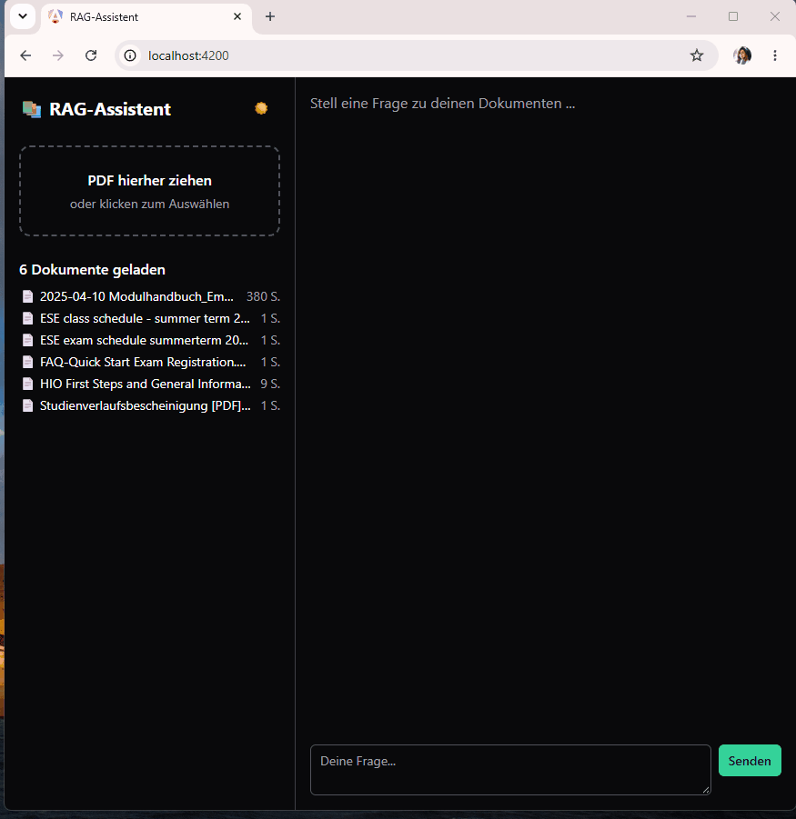
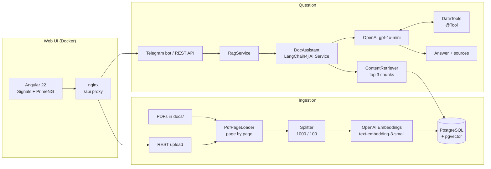
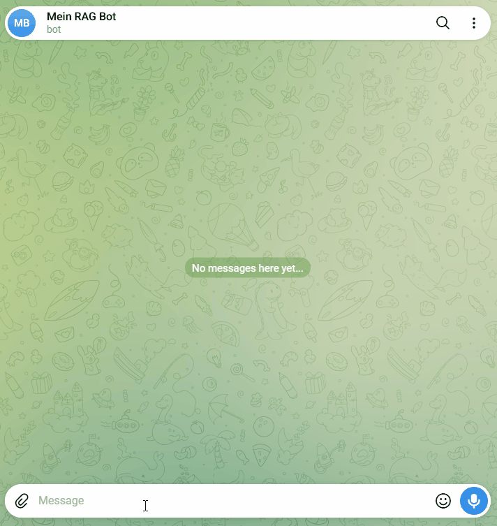

# RAG Document Assistant (Angular Web UI + Telegram Bot + REST API)

A full-stack app that answers questions about **your own PDF documents** and gives **the source (file and page)** for each answer. If the answer is not in the documents, it says so instead of making something up.

**Angular** (Signals, PrimeNG) ⇄ **Spring Boot** REST ⇄ **LangChain4j** ⇄ **pgvector**. The whole stack starts with one `docker compose up`.



**Example**

> 👤 `/ask How long do I have to submit my Master's thesis?`
> 🤖 Du hast nach der Anmeldung 26 Wochen Zeit.
> 📄 Quelle: Thesis guideline v07.pdf, S. 8

(The bot answers in German; the documents can be in any language.)

## Features

- 🖥️ **Web UI (Angular)**: chat with source chips, PDF upload with drag & drop and a progress bar, a live document list, and dark mode
- 📚 **RAG with sources**: PDFs are read page by page, split into chunks, embedded and stored in **pgvector**. Each answer lists the file and page it came from.
- 🙅 **Honest refusal**: questions outside the documents get *"Das steht nicht in meinen Dokumenten."* ("That is not in my documents.")
- 🧾 **Structured output**: `/fristen <topic>` extracts deadlines and dates as Java objects (`record Deadline(String title, LocalDate date)`), sorted in Java.
- 🛠️ **Function calling**: the LLM calls Java methods (`@Tool`) for date math, for example "How many days until …?"
- 📊 **Evaluation suite**: a JUnit eval with 20 questions measures answer accuracy, source accuracy and refusal rate. I used it to choose the chunk size.
- 💬 **Telegram bot** with commands and chat memory per user
- 🌐 **REST API** to ask questions and upload new PDFs

## Architecture



## Tech Stack

**Backend:** Java 17 · Spring Boot 3.3 · LangChain4j 0.34 · OpenAI (gpt-4o-mini, text-embedding-3-small) · PostgreSQL + pgvector · Apache PDFBox · JUnit 5 · TelegramBots 6.9

**Frontend:** Angular 22 (standalone, Signals, zoneless) · NgRx Signals · PrimeNG 22 (Aura theme) · Tailwind CSS 4 · TypeScript

**DevOps:** Docker Compose (pgvector, backend, nginx + frontend) · GitHub Actions

## Frontend

The web UI lives in [`frontend/`](frontend/).

| Feature | How it works |
|---|---|
| Chat | `Chat` component. The state is plain signals (`messages`, `loading`, `error`). Enter sends, Shift+Enter adds a new line. `afterRenderEffect` scrolls to the newest message. |
| Source chips | A small reusable component with a signal input (`input.required<string[]>()`) and PrimeNG `p-chip` |
| PDF upload | Drag & drop or file picker. The progress comes from `HttpEventType.UploadProgress` (`reportProgress: true, observe: 'events'`). After 100 % it shows a "processing" state, because the backend still creates the embeddings. It checks for PDF only and max. 20 MB. |
| Document list | An **NgRx `signalStore`** (`withState`, `withComputed`, `withMethods`, `withHooks`). The upload calls `store.reload()`, so the list updates by itself. |
| API access | One typed service (`RagApi`) with `HttpClient`. In development, `proxy.conf.json` forwards `/api` to the backend, so no CORS is needed. |
| Layout | Tailwind, mobile first: the sidebar sits above the chat on small screens. Dark mode toggle: PrimeNG and Tailwind both use the `.app-dark` class, and the choice is saved in `localStorage`. |
| Accessibility | `aria-live="polite"` for new answers, labels on inputs, a keyboard-accessible file input (`sr-only` instead of `hidden`) |

In Docker, **nginx** serves the built app and forwards `/api` to the backend container. It allows uploads up to 20 MB (`client_max_body_size`) and waits up to 5 minutes, because embedding a large PDF takes time.

## Evaluation

The eval set has 20 questions: 16 whose answer is in the documents and 4 whose answer is not. Each question has expected keywords and, if it has an answer, the expected file and page.

| Chunk / Overlap | maxResults | Answer correct | Source correct | Refusal correct |
|---|---|---|---|---|
| **1000 / 100** | **3** | **94 %** | 94 % | 100 % |
| 1000 / 100 | 5 | 94 % | 94 % | 100 % |
| 500 / 50 | 5 | 88 % | 100 % | 100 % |
| 300 / 30 | 5 | 81 % | 88 % | 100 % |

**Findings**

- **Small chunks** find the right page more precisely, but they cut **tables** apart. The LLM then mixes up rows, for example the wrong exam duration or the wrong lecturer.
- **Large chunks** keep the context together, so the answers are better.
- **maxResults 3 vs. 5:** the same quality, with a shorter prompt, so it is cheaper and faster.
- **Refusal was 100 % in every setup**: no made-up answers for questions outside the documents.

➡️ Chosen setup: **chunk size 1000, overlap 100, maxResults 3**.

> ⚠️ **For local use only.** The REST API has no authentication (see [Known Limitations](#known-limitations)).

## Getting Started

### 1. Prerequisites

- Docker Desktop
- An OpenAI API key
- A Telegram bot token from [@BotFather](https://t.me/BotFather)
- A **PrimeUI license key**. PrimeNG 21+ is not MIT anymore; the [Community License](https://primeui.dev/licenses/community) is free for individuals, students and small teams. Without a key the app still works, but it shows an "Invalid PrimeUI License" banner.
- Only for local development: Java 17+ and Node.js 22+

### 2. Configuration

Create `telegram-chatbot/.env` (it is in `.gitignore`, so it never ends up on GitHub):

```
OPENAI_API_KEY=sk-...
TELEGRAM_BOT_NAME=...
TELEGRAM_BOT_TOKEN=...
TELEGRAM_ADMIN_CHAT_ID=...
```

| Variable | Description |
|---|---|
| `OPENAI_API_KEY` | Your OpenAI API key |
| `TELEGRAM_BOT_NAME` | Bot username |
| `TELEGRAM_BOT_TOKEN` | Bot token from BotFather |
| `TELEGRAM_ADMIN_CHAT_ID` | Your Telegram chat ID (only this chat may use `/reindex`) |
| `RAG_DOCSFOLDER` | Optional. Path to the PDF folder (`rag.docs-folder`). Use `../docs` when you start the backend from `telegram-chatbot/` without Docker |

Copy the license template. **The frontend does not build without this file**:

```bash
# macOS / Linux / Git Bash
cp frontend/src/app/primeui-license.example.ts frontend/src/app/primeui-license.ts
```

```powershell
# Windows PowerShell
Copy-Item frontend/src/app/primeui-license.example.ts frontend/src/app/primeui-license.ts
```

Then put your key into `primeui-license.ts` (it is in `.gitignore`):

```ts
export const PRIMEUI_LICENSE = 'your-license-key';
```

If you leave the key empty (`''`), the app still builds and runs, but PrimeNG shows an "Invalid PrimeUI License" banner.

Put your PDFs into `docs/`. The PDFs need real text; scanned PDFs without a text layer do not work.

### 3. Run everything with Docker

```bash
cd telegram-chatbot
docker compose up -d --build
```

| Container | Port | |
|---|---|---|
| `rag-frontend` | **http://localhost:4200** | nginx with the Angular app |
| `rag-backend` | http://localhost:8090 | Spring Boot (`docs/` is mounted into the container) |
| `rag-db` | 5432 | PostgreSQL + pgvector, with a healthcheck so the backend waits for it |

To load the PDFs from `docs/` into the database, send `/reindex` in Telegram, or add `RAG_INGEST_ON_STARTUP=true` to `.env` for the first start. PDFs uploaded in the web UI are indexed right away.

### 4. Local development (optional)

```bash
cd telegram-chatbot
docker compose up -d pgvector          # only the database
./mvnw spring-boot:run                 # backend on :8090 (set the variables from .env)

cd ../frontend
npm install
npm start                              # http://localhost:4200, /api is proxied to :8090
```

> Do not run the backend in Docker and locally at the same time: both use port 8090 and the same Telegram token.

## Usage

### Web UI

Open **http://localhost:4200**, drop a PDF into the upload area, and ask a question. The sources appear as chips under each answer.

### Telegram commands



| Command | Description |
|---|---|
| `/ask <question>` | Ask a question about the documents (RAG, with sources) |
| `/fristen <topic>` | List the deadlines and dates for a topic (structured output) |
| `/docs` | List the loaded documents |
| `/reindex` | Read the `docs/` folder again (admin only) |
| any other message | Normal chat without documents |

### REST API

**Ask a question**

```bash
curl -X POST http://localhost:8090/api/rag/ask \
  -H "Content-Type: application/json" \
  -d '{"sessionId": 1, "question": "When is the Applied Embedded Systems exam?"}'
```

```json
{
  "answer": "Die Prüfung findet am 20.06.2026 von 10:15 bis 15:50 Uhr statt.",
  "sources": ["ESE exam schedule summerterm 2026.pdf, S. 1"]
}
```

**Upload a PDF**

```bash
curl -F "file=@my-document.pdf" http://localhost:8090/api/rag/documents
```

### Run the evaluation

The eval calls the real OpenAI API, so it has the tag `@Tag("eval")` and is not part of the normal test run. Stop the app first, because the test starts its own Telegram bot.

```bash
./mvnw test -Dgroups=eval -DexcludedGroups=
```

## CI

GitHub Actions runs two jobs in parallel on every pull request:

- **build** (backend): `./mvnw test` with a pgvector service container. The eval tests are excluded there (`excludedGroups=eval` in `pom.xml`).
- **frontend**: `npm ci` and `npm run build`. The PrimeUI license file is created from the GitHub Secret `PRIMEUI_LICENSE`, so the key is never in the repository.

## Configuration

All RAG settings are in `application.properties`:

```properties
rag.chunk-size=1000
rag.chunk-overlap=100
rag.max-results=3
rag.min-score=0.6
```

## Known Limitations

- 🔓 **No authentication on the REST API**: anyone who can reach it can upload PDFs and cause OpenAI costs. **For local use only.** Do not expose it to the internet.
- 🖼️ **No OCR**: scanned PDFs cannot be read.
- 📋 **Tables**: a table that is split across chunks can lead to mixed-up answers (see Evaluation).
- 🧪 **Simple eval check**: answers are checked with keyword matching. Short numbers like `"20"` can match by accident (for example inside `2026`).
- 📝 **Markdown is shown as plain text**: the LLM sometimes answers with `**bold**` or lists, and the web UI does not render Markdown yet.
- 🧩 **No automated frontend tests**: the frontend is checked by the TypeScript compiler and the production build in CI, but there are no unit or E2E tests.
- 🔑 **PrimeUI license**: you need your own (free) PrimeUI key to build the frontend without the license banner.

## What I Learned

- **Chunk size is a trade-off.** Small chunks give precise retrieval but lose context. My eval numbers showed this clearly.
- **The user message is also the retrieval query.** Put instructions into the `@SystemMessage`; otherwise they dilute the search. Moving them there fixed my `/fristen` command.
- **Measure, don't guess.** The eval confirmed that chunk size 1000 is the best choice, and it showed that `maxResults` 3 is as good as 5 but cheaper. I could not have seen that by testing a few questions by hand.
- **The LLM only knows what you tell it.** It did not know today's date (fixed with `{{current_date}}`), and it misread a negative tool result until I explained it in the `@Tool` description.
- **Debug with logs.** Request logging showed me whether the right chunks reached the LLM. That told me whether a wrong answer came from retrieval or from generation.
- **Signals are functions.** `documents.length` compiled without errors but was always `0`, because it is the length of the signal *function*. The correct form is `documents().length`.
- **Uploads have more limits than you think.** Spring allows 20 MB, but nginx allows only 1 MB by default (`client_max_body_size`), and its 60-second timeout is too short for embedding a 380-page PDF.
- **Keep secrets out of git, and keep CI working anyway.** `.env` and the license file are ignored; the CI creates the license file from a GitHub Secret. A file that is already staged is *not* ignored, so I had to remove it with `git rm --cached`.
- **Check licenses before you add a dependency.** PrimeNG changed from MIT to its own license with version 21. I only noticed it because of the banner in the UI.

## How I Used AI

I built the frontend with **Claude Code** as a tutor and reviewer, not as a code generator:

- **Roadmap first.** I followed a step-by-step roadmap (setup → API service → chat → upload → store → UX → Docker → CI) and worked through it in small steps, with one commit per step.
- **I wrote the code myself.** For each step, Claude explained the concept (for example Signals, HTTP upload events, `signalStore`), and then I implemented it.
- **AI as a reviewer.** After each step, Claude read my diff, ran the TypeScript compiler and the build, and pointed out bugs: a decorator placed above a `const` instead of the class, a wrong upload URL that would only fail at runtime, `documents.length` on a signal, and YAML indentation errors in `docker-compose.yml` and the CI workflow.
- **Debugging together.** It read logs and system state to find causes: `ECONNREFUSED` (backend not running), port 8090 already in use, IntelliJ no longer recognizing the Maven module, and a full C: drive (Docker's disk image).
- **Verifying the AI.** The AI also made mistakes. For example, it recommended PrimeNG without checking the license first. I only found this because I tested in the real app and saw the license banner, so I always check suggestions myself.

My takeaway: AI makes me much faster at learning a new stack, but I still have to understand every line and test the result myself.
